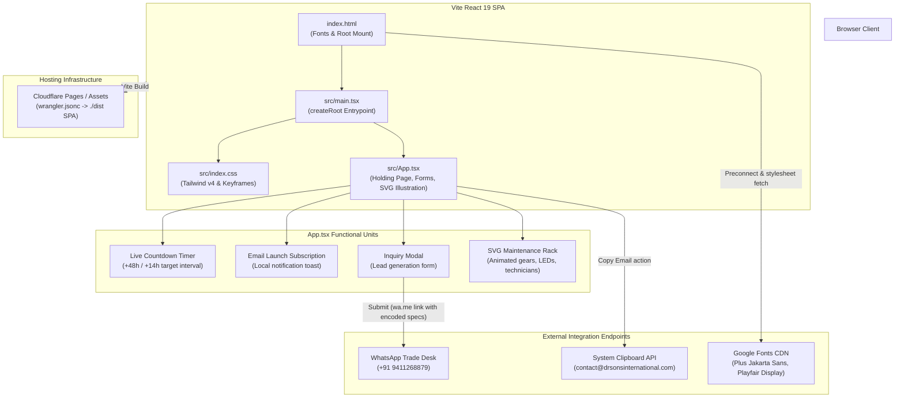

# Architecture Overview: DrSons International Portal

## 1. System Summary

DrSons International is a digital holding and commercial operations web application designed for a premier food processing and commercial manufacturing enterprise ([README.md:1-21](file:///C:/Users/ASUS%20PC/.gemini/antigravity/worktrees/8464c7cb-1913-4e11-82d3-7ea8e440598e/subagent-Codebase-Researcher-gsd-researcher-798c8ce9/README.md#L1-L21)). The current implementation functions as an interactive commercial holding portal while back-end infrastructure is staged, providing lead capture, launch timer visualization, brand identity, and a direct inquiry workflow routing prospective corporate partners to the company's WhatsApp trade desk ([README.md:24-34](file:///C:/Users/ASUS%20PC/.gemini/antigravity/worktrees/8464c7cb-1913-4e11-82d3-7ea8e440598e/subagent-Codebase-Researcher-gsd-researcher-798c8ce9/README.md#L24-L34), [src/App.tsx:100-123](file:///C:/Users/ASUS%20PC/.gemini/antigravity/worktrees/8464c7cb-1913-4e11-82d3-7ea8e440598e/subagent-Codebase-Researcher-gsd-researcher-798c8ce9/src/App.tsx#L100-L123)).

The application is structured as a client-side Single Page Application (SPA) built on React 19, Vite 8, and Tailwind CSS v4, deployed to Cloudflare Pages ([wrangler.jsonc:5-8](file:///C:/Users/ASUS%20PC/.gemini/antigravity/worktrees/8464c7cb-1913-4e11-82d3-7ea8e440598e/subagent-Codebase-Researcher-gsd-researcher-798c8ce9/wrangler.jsonc#L5-L8), [package.json:19,21](file:///C:/Users/ASUS%20PC/.gemini/antigravity/worktrees/8464c7cb-1913-4e11-82d3-7ea8e440598e/subagent-Codebase-Researcher-gsd-researcher-798c8ce9/package.json#L19-L21)).

---

## 2. Architecture Diagram

---

## 3. Directory Layout & File Responsibilities

| Path | Category | Purpose & Key Details |
| :--- | :--- | :--- |
| `index.html` | Entrypoint | HTML shell; loads Google Fonts (`Plus Jakarta Sans`, `Playfair Display`) and bootstraps `/src/main.tsx` ([index.html:14,18](file:///C:/Users/ASUS%20PC/.gemini/antigravity/worktrees/8464c7cb-1913-4e11-82d3-7ea8e440598e/subagent-Codebase-Researcher-gsd-researcher-798c8ce9/index.html#L14-L18)). |
| `src/main.tsx` | Entrypoint | React 19 root bootstrap invoking `createRoot` on `#root` ([src/main.tsx:1-6](file:///C:/Users/ASUS%20PC/.gemini/antigravity/worktrees/8464c7cb-1913-4e11-82d3-7ea8e440598e/subagent-Codebase-Researcher-gsd-researcher-798c8ce9/src/main.tsx#L1-L6)). |
| `src/App.tsx` | View Component | Monolithic top-level view combining navigation, countdown timer, SVG illustration, newsletter subscription, and commercial inquiry modal ([src/App.tsx:24-725](file:///C:/Users/ASUS%20PC/.gemini/antigravity/worktrees/8464c7cb-1913-4e11-82d3-7ea8e440598e/subagent-Codebase-Researcher-gsd-researcher-798c8ce9/src/App.tsx#L24-L725)). |
| `src/index.css` | Styling | Tailwind CSS v4 root (`@import "tailwindcss";`), base font declarations, and custom keyframe animations (`marquee`, `pulse-glow`, `wave-scan`) ([src/index.css:1-65](file:///C:/Users/ASUS%20PC/.gemini/antigravity/worktrees/8464c7cb-1913-4e11-82d3-7ea8e440598e/subagent-Codebase-Researcher-gsd-researcher-798c8ce9/src/index.css#L1-L65)). |
| `public/assets/aistudio/` | Static Assets | Contains generated artwork and imagery, including the brand mark used in navbar ([src/App.tsx:148](file:///C:/Users/ASUS%20PC/.gemini/antigravity/worktrees/8464c7cb-1913-4e11-82d3-7ea8e440598e/subagent-Codebase-Researcher-gsd-researcher-798c8ce9/src/App.tsx#L148)). |
| `vite.config.ts` | Configuration | Configures Vite 8 with `@vitejs/plugin-react` and `@tailwindcss/vite`, path aliasing `@` to root, and HMR toggles via `DISABLE_HMR` ([vite.config.ts:1-22](file:///C:/Users/ASUS%20PC/.gemini/antigravity/worktrees/8464c7cb-1913-4e11-82d3-7ea8e440598e/subagent-Codebase-Researcher-gsd-researcher-798c8ce9/vite.config.ts#L1-L22)). |
| `tsconfig.json` | Configuration | TypeScript bundler configuration targeting ES2022 with React JSX transform and `@/*` path mapping ([tsconfig.json:1-29](file:///C:/Users/ASUS%20PC/.gemini/antigravity/worktrees/8464c7cb-1913-4e11-82d3-7ea8e440598e/subagent-Codebase-Researcher-gsd-researcher-798c8ce9/tsconfig.json#L1-L29)). |
| `wrangler.jsonc` | Deployment | Cloudflare Workers / Pages configuration serving `./dist` with SPA route fallback ([wrangler.jsonc:1-10](file:///C:/Users/ASUS%20PC/.gemini/antigravity/worktrees/8464c7cb-1913-4e11-82d3-7ea8e440598e/subagent-Codebase-Researcher-gsd-researcher-798c8ce9/wrangler.jsonc#L1-L10)). |
| `metadata.json` | Project Metadata | AI Studio configuration declaring portal metadata and server-side Gemini capability ([metadata.json:1-6](file:///C:/Users/ASUS%20PC/.gemini/antigravity/worktrees/8464c7cb-1913-4e11-82d3-7ea8e440598e/subagent-Codebase-Researcher-gsd-researcher-798c8ce9/metadata.json#L1-L6)). |
| `.env.example` | Environment Template | Documents expected secrets `GEMINI_API_KEY` and host URL `APP_URL` ([.env.example:1-10](file:///C:/Users/ASUS%20PC/.gemini/antigravity/worktrees/8464c7cb-1913-4e11-82d3-7ea8e440598e/subagent-Codebase-Researcher-gsd-researcher-798c8ce9/.env.example#L1-L10)). |

---

## 4. Component Details & Data Flow

### 4.1 State Management
Currently, state is completely localized inside `src/App.tsx` using native React hooks (`useState`, `useEffect`):
- **Countdown Timer (`timeLeft`)**: Initialized with a synthetic target 2 days + 14 hours in the future; continuously updated every 1000ms via `setInterval` ([src/App.tsx:35-68](file:///C:/Users/ASUS%20PC/.gemini/antigravity/worktrees/8464c7cb-1913-4e11-82d3-7ea8e440598e/subagent-Codebase-Researcher-gsd-researcher-798c8ce9/src/App.tsx#L35-L68)).
- **Email Lead Capture (`emailInput`, `isSubscribed`)**: Captures user email; displays inline confirmation and toast notification ([src/App.tsx:86-91](file:///C:/Users/ASUS%20PC/.gemini/antigravity/worktrees/8464c7cb-1913-4e11-82d3-7ea8e440598e/subagent-Codebase-Researcher-gsd-researcher-798c8ce9/src/App.tsx#L86-L91)). (Note: Client-side only; no backend storage endpoint is currently invoked).
- **Commercial Inquiry Workflow (`inquiryForm`, `showInquiryModal`, `inquirySubmitted`, `redirectCountdown`)**:
  - Captures `name`, `company`, `email`, `category` (Produce, Beverages & Ice Cream, Specialty Foods, Farm Vendor), and `message` ([src/App.tsx:71-77](file:///C:/Users/ASUS%20PC/.gemini/antigravity/worktrees/8464c7cb-1913-4e11-82d3-7ea8e440598e/subagent-Codebase-Researcher-gsd-researcher-798c8ce9/src/App.tsx#L71-L77), [src/App.tsx:644-655](file:///C:/Users/ASUS%20PC/.gemini/antigravity/worktrees/8464c7cb-1913-4e11-82d3-7ea8e440598e/subagent-Codebase-Researcher-gsd-researcher-798c8ce9/src/App.tsx#L644-L655)).
  - Serializes fields into structured text and builds a `https://wa.me/919411268879?text=...` URI ([src/App.tsx:104-114](file:///C:/Users/ASUS%20PC/.gemini/antigravity/worktrees/8464c7cb-1913-4e11-82d3-7ea8e440598e/subagent-Codebase-Researcher-gsd-researcher-798c8ce9/src/App.tsx#L104-L114)).
  - Triggers a 3-second countdown timer before redirecting `window.location.href` to WhatsApp, while also providing an explicit manual click link ([src/App.tsx:117-123](file:///C:/Users/ASUS%20PC/.gemini/antigravity/worktrees/8464c7cb-1913-4e11-82d3-7ea8e440598e/subagent-Codebase-Researcher-gsd-researcher-798c8ce9/src/App.tsx#L117-L123), [src/App.tsx:695-704](file:///C:/Users/ASUS%20PC/.gemini/antigravity/worktrees/8464c7cb-1913-4e11-82d3-7ea8e440598e/subagent-Codebase-Researcher-gsd-researcher-798c8ce9/src/App.tsx#L695-L704)).
- **Feedback & Toasts (`notification`)**: Automatically dismisses toast notifications after 3500ms ([src/App.tsx:79-84](file:///C:/Users/ASUS%20PC/.gemini/antigravity/worktrees/8464c7cb-1913-4e11-82d3-7ea8e440598e/subagent-Codebase-Researcher-gsd-researcher-798c8ce9/src/App.tsx#L79-L84), [src/App.tsx:136-142](file:///C:/Users/ASUS%20PC/.gemini/antigravity/worktrees/8464c7cb-1913-4e11-82d3-7ea8e440598e/subagent-Codebase-Researcher-gsd-researcher-798c8ce9/src/App.tsx#L136-L142)).

### 4.2 Animated Vector Graphics
The right column features an extensive inline SVG illustration rendered directly in the DOM without external SVG file loads ([src/App.tsx:295-533](file:///C:/Users/ASUS%20PC/.gemini/antigravity/worktrees/8464c7cb-1913-4e11-82d3-7ea8e440598e/subagent-Codebase-Researcher-gsd-researcher-798c8ce9/src/App.tsx#L295-L533)):
- Dual rotating mechanical gears using SVG `<animateTransform>` ([src/App.tsx:318-366](file:///C:/Users/ASUS%20PC/.gemini/antigravity/worktrees/8464c7cb-1913-4e11-82d3-7ea8e440598e/subagent-Codebase-Researcher-gsd-researcher-798c8ce9/src/App.tsx#L318-L366)).
- Server rack blades with individual blinking LED status lights and moving laser scan beams ([src/App.tsx:390-445](file:///C:/Users/ASUS%20PC/.gemini/antigravity/worktrees/8464c7cb-1913-4e11-82d3-7ea8e440598e/subagent-Codebase-Researcher-gsd-researcher-798c8ce9/src/App.tsx#L390-L445)).
- Illustrated technician figures at a workstation and ladder ([src/App.tsx:459-528](file:///C:/Users/ASUS%20PC/.gemini/antigravity/worktrees/8464c7cb-1913-4e11-82d3-7ea8e440598e/subagent-Codebase-Researcher-gsd-researcher-798c8ce9/src/App.tsx#L459-L528)).

---

## 5. Latent Architecture & Future Extensibility

Several backend and AI capabilities are staged in configuration and dependencies but are not yet implemented in application logic:
1. **Gemini AI Service**: `@google/genai` is installed ([package.json:15](file:///C:/Users/ASUS%20PC/.gemini/antigravity/worktrees/8464c7cb-1913-4e11-82d3-7ea8e440598e/subagent-Codebase-Researcher-gsd-researcher-798c8ce9/package.json#L15)), `MAJOR_CAPABILITY_SERVER_SIDE_GEMINI_API` is declared ([metadata.json:5](file:///C:/Users/ASUS%20PC/.gemini/antigravity/worktrees/8464c7cb-1913-4e11-82d3-7ea8e440598e/subagent-Codebase-Researcher-gsd-researcher-798c8ce9/metadata.json#L5)), and `GEMINI_API_KEY` is documented in [.env.example:4](file:///C:/Users/ASUS%20PC/.gemini/antigravity/worktrees/8464c7cb-1913-4e11-82d3-7ea8e440598e/subagent-Codebase-Researcher-gsd-researcher-798c8ce9/.env.example#L4), but no code currently imports `@google/genai`.
2. **Server-Side API**: `express`, `@types/express`, and `dotenv` are installed in dependencies ([package.json:22-23,34](file:///C:/Users/ASUS%20PC/.gemini/antigravity/worktrees/8464c7cb-1913-4e11-82d3-7ea8e440598e/subagent-Codebase-Researcher-gsd-researcher-798c8ce9/package.json#L22-L23), [package.json:34](file:///C:/Users/ASUS%20PC/.gemini/antigravity/worktrees/8464c7cb-1913-4e11-82d3-7ea8e440598e/subagent-Codebase-Researcher-gsd-researcher-798c8ce9/package.json#L34)), and `package.json:11` references cleaning `server.js` (`"clean": "rm -rf dist server.js"`), but no server entrypoint file (`server.ts` or `server.js`) currently exists in the repository.
3. **Motion Library**: `motion` is in dependencies ([package.json:24](file:///C:/Users/ASUS%20PC/.gemini/antigravity/worktrees/8464c7cb-1913-4e11-82d3-7ea8e440598e/subagent-Codebase-Researcher-gsd-researcher-798c8ce9/package.json#L24)), but UI animations are currently implemented using raw CSS keyframes and SVG animations ([src/index.css:18-64](file:///C:/Users/ASUS%20PC/.gemini/antigravity/worktrees/8464c7cb-1913-4e11-82d3-7ea8e440598e/subagent-Codebase-Researcher-gsd-researcher-798c8ce9/src/index.css#L18-L64)).

---

## 6. Unknowns & Undetermined Elements

- **Lead Storage Target**: Neither email newsletter subscriptions nor commercial manufacturing inquiries are saved to a persistent database or API endpoint (both execute purely in-memory/client-side before triggering WhatsApp redirect or toast). Whether this will transition to a Cloudflare Worker D1/KV storage or an Express/Node backend remains undetermined from current code.
- **Server File Implementation**: `package.json:11` script implies `server.js` was or will be generated/run, but no server code exists in `src` or root.

